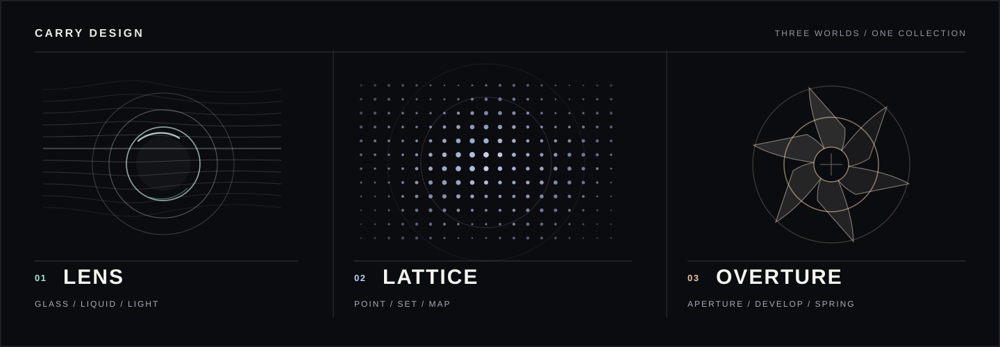

<div align="center">



# Carry Design

### 让设计，自成一套。

**Three native Web design systems. Three ways to experience an interface.**

[探索设计体系](#三套体系三种表达) · [即刻体验](#即刻体验) · [开始使用](#开始使用) · [代码结构](#代码结构)

[](LICENSE)


</div>

<br />

> **让每一次交互，都有自己的语言。**
>
> 玻璃会折射。点阵会生长。光圈会开合。
>
> 三套建立在原生 Web 之上的设计体系，从材质、几何与运动出发，把视觉规则延伸到真正可操作的按钮、表单、导航、图表和完整页面。
>
> **看得见的设计，也摸得着它的逻辑。**

---

## 一次曝光。三重感官。

同一块屏幕，可以有三种截然不同的表达。

**Lens / 透镜** 让界面像玻璃一样回应触碰。**Lattice / 点阵** 让信息从一个个点中汇聚成形。**Overture / 序曲** 把摄影、舞台与印刷的动作带进数字世界。

它们各自拥有独立的材质、动效、声音与组件系统。联合展示站点让三个世界在一次浏览中自然衔接。

| | **01 · Lens 透镜** | **02 · Lattice 点阵** | **03 · Overture 序曲** |
|:--|:--|:--|:--|
| 设计语法 | 玻璃 · 液体 · 光 | 点 · 集 · 映射 | 光圈 · 显影 · 弹簧 |
| 组件规模 | 18 类公共组件 | 14 类组件 | 46 类组件 |
| 图形技术 | WebGL2 | three.js · WebGL2 | WebGPU · WebGL2 |
| 完整展示 | [开始体验](lens/lens-showcase-standalone.html) | [开始体验](lattice/dist/lattice-showcase.html) | [开始体验](overture/dist/overture-showcase.html) |
| 技术文档 | [阅读](lens/lab/design-system/README.md) | [阅读](lattice/README.md) | [阅读](overture/README.md) |

**从整体开始。** 仓库根目录的 [index.html](index.html) 是联合展示站点。所见的材质、粒子和动画来自各体系自己的实时渲染代码。

<br />

## 三套体系，三种表达

### 01 — Lens · 透镜

#### 让玻璃，有了触感。

透明，可以有更多层次。

Lens 用**玻璃**承载信息，用**液体**表达连续变化，再让**光**成为状态的语言。界面会随手势延展，会在松开后柔和回弹。来自场景纹理的真实采样，让折射、色散、边缘高光和雾化共同形成富有深度的玻璃质感。

**从第一眼的通透，到每一次操作的回应。**

| 体验 | 源码中的实现 |
|---|---|
| **折射** | WebGL2、背景纹理采样、距离场边缘法线、色散、雾化与反光 |
| **弹性** | 阻尼弹簧、指针捕获、拖拽形变与释放回弹 |
| **18 类公共组件** | 按钮、开关、滑块、菜单、标签、导航、卡片列表、自由透镜、二维滑块等 |
| **4 种数据组合** | 折线、柱形、环图与记录表，共享选择与过滤状态 |
| **声音** | 13 种合成短音效、连续摩擦音；默认关闭 |
| **原生交互** | 语义 HTML 承担文本、焦点和输入；GPU 负责材质 |
| **复用** | 零运行时第三方依赖的 ES module 包、TypeScript 声明、CSS 与 JSON Tokens |

**亲手试试：** [完整单文件](lens/lens-showcase-standalone.html) · [中文展示](lens/lens-showcase.html) · [English](lens/lens-showcase-en.html) · [材质实验室](lens/lens.html) · [18 类组件清单](lens/lab/design-system/COMPONENTS.md)

<details>
<summary><strong>深入一层 · Lens 的架构</strong></summary>

<br />

由 [index.js](lens/lab/design-system/index.js) 统一导出公共 API。组件工厂位于 [components.js](lens/lab/design-system/components.js)，可复用横向卡片列表位于 [card-list.js](lens/lab/design-system/card-list.js)。

[runtime.js](lens/lab/design-system/runtime.js) 管理光学渲染、手势、声音、组件挂载与资源销毁。[internal/renderer.js](lens/lab/design-system/internal/renderer.js) 负责 WebGL 绘制；[internal/jelly.js](lens/lab/design-system/internal/jelly.js) 负责弹性物理；[sound.js](lens/lab/design-system/sound.js) 合成交互反馈。

折射使用系统画布内的场景纹理。应用可通过自定义 artwork 绘制需要被折射的背景。WebGL2 不可用时，组件回退为 CSS 玻璃材质。

[完整组件 API](lens/lab/design-system/README.md) · [系统范围与复用规范](lens/lab/design-system/SCOPE.md) · [交互规范](lens/lab/design-system/INTERACTIONS.md)

</details>

---

### 02 — Lattice · 点阵

#### 从一点，看到万千可能。

一点，可以是一粒微光。万点，可以成为一套世界。

Lattice 以**点、集合与映射**构建图形语言。文字散开又聚拢，几何体从粒子中出现，抽象的定理依赖化为可探索的瀑布。每一次变化，都对应着点集之间的真实映射。

**看得见结果，也看得见它如何形成。**

| 体验 | 源码中的实现 |
|---|---|
| **GPU 粒子场** | 桌面目标规模 65,536 点，移动端 25,600 点；弹簧与流场驱动点集变化 |
| **点集形状** | 5×7 点阵字、洛伦兹吸引子、三叶结、晶体、克莱因瓶、斐波那契球 |
| **定理之瀑** | 依赖 DAG 化作水流；悬停追踪前提与结论 |
| **证明树** | 从结论向公理生长，展示推导关系和切换动画 |
| **3D 舞台** | 单 WebGL 上下文、滚动镜头、辉光、自适应像素比与离屏暂停 |
| **14 类组件** | 点阵字、加载器、光标、按钮、标签页、开关、滑块、进度与命令面板 |
| **录制模式** | 时间驱动的确定性逐帧渲染，可用于截图与视频素材制作 |

系统中的 [实分析依赖数据](lattice/src/data/analysis.js) 为定理之瀑与证明树提供示例。课程知识图谱、任务依赖、项目流程，也可以采用相同的数据结构呈现。

**亲手试试：** [完整粒子演示](lattice/dist/lattice-showcase.html) · [交互组件目录](lattice/dist/catalog/index.html) · [设计规范](lattice/DESIGN.md) · [开发说明](lattice/README.md)

<details>
<summary><strong>深入一层 · Lattice 的图形结构</strong></summary>

<br />

[stage.js](lattice/src/gl/stage.js) 管理 three.js 场景、镜头和调度。[field.js](lattice/src/gl/field.js) 用 GPU 计算点的状态和运动；[sets.js](lattice/src/gl/sets.js) 定义不同几何集合；[cascade.js](lattice/src/gl/cascade.js) 与 [prooftree.js](lattice/src/gl/prooftree.js) 让依赖关系可视化。

核心时钟、弹簧、主题与声音位于 [src/core](lattice/src/core)，语义化交互控件位于 [src/dom](lattice/src/dom)。公共模块入口是 [src/index.js](lattice/src/index.js)。

构建使用固定的 three.js 版本和 esbuild，生成已内嵌运行脚本的 HTML。Web 字体在线加载失败时使用系统字体。

[接入示例与工具说明](lattice/README.md) · [验证记录](lattice/VERIFICATION.md)

</details>

---

### 03 — Overture · 序曲

#### 光影登场，交互入戏。

一束光，引导目光。一张底片，等待显影。一段恰到好处的回弹，让每一次操作都拥有节奏。

Overture 从**摄影、歌剧与时装**出发，以**光圈、显影、弹簧**建立统一运动语法。它把舞台的沉浸感、摄影的观看方式和印刷品的精细秩序带进可操作的 Web 界面。

**让每一次开合，都有自己的仪式感。**

<div align="center">


<sub>三张原始视觉参考图 · Overture</sub>

</div>

| 体验 | 源码中的实现 |
|---|---|
| **46 类组件** | 七个家族，覆盖导航、表单、浮层、反馈、内容、影像与品牌 |
| **三种主题** | Stage 暗场、Paper 印纸、Nocturne 夜场 |
| **统一运动核心** | 光圈开合、显影、翻片与弹簧在 Overture.motion 中协同 |
| **光影交互** | 追光照片墙、胶片暗盒、相纸显影、取景与布料共振 |
| **图形引擎** | three.js / TSL；优先 WebGPU，回退 WebGL2 或静态呈现 |
| **品牌工坊** | 组合品牌画面，支持 PNG / WebM 导出 |
| **完整离线演示** | 单个 HTML 内嵌样式、脚本、字体、照片、图形引擎与 720p 宣传片 |

舞台可以是暖色的，焦点可以是冷色的。朱红提示动作与选择。冷光引导注意力。材料、色彩与动作各有分工，让体验始终保持统一。

**亲手试试：** [完整单文件](overture/dist/overture-showcase.html) · [沉浸展示](overture/dist/index.html) · [追光实验](overture/dist/light-studies.html) · [组件库](overture/dist/components.html) · [品牌工坊](overture/dist/studio.html) · [设计目录](overture/dist/catalog/index.html)

<details>
<summary><strong>深入一层 · Overture 的运动与组件结构</strong></summary>

<br />

[core.js](overture/src/core.js) 提供组件注册、状态、事件与生命周期。[dynamics.js](overture/src/dynamics.js) 统一光圈、显影、重排与阻尼弹簧。

控件按模块拆分到 [controls](overture/src/controls.js)、[overlays](overture/src/overlays.js)、[media](overture/src/media.js)、[light](overture/src/light.js)、[film](overture/src/film.js)、[brand](overture/src/brand.js)。[engine.mjs](overture/src/engine.mjs) 则承担 GPU 图形实验。

[components catalog](overture/src/catalog-data.mjs) 定义组件元信息；[tokens.json](overture/project/tokens.json) 管理主题、字体、颜色与动效变量。

织物采用摄影纹理与 2.5D GPU 曲面变形，保留图像材料的细节。公开 API、资源生命周期和主题切换见 [接入文档](overture/project/guidelines/30-api.md)。

</details>

<br />

## 即刻体验

### 先看，再动手。

| 入口 | 看什么 |
|---|---|
| [联合展示 / index.html](index.html) | 六个展示场景的衔接、过场与三种设计语法 |
| [Lens 独立演示](lens/lens-showcase-standalone.html) | 真折射、材质、组件、弹性与声音 |
| [Lattice 独立演示](lattice/dist/lattice-showcase.html) | GPU 点场、集合变形、定理依赖与证明树 |
| [Overture 独立演示](overture/dist/overture-showcase.html) | 光圈、显影、追光、胶片和完整品牌演示 |

单文件展示已内嵌运行资源；联合站点和跨文件的 ES module 开发示例建议通过本地 HTTP 服务访问。

### 一条命令，让三个世界同时登场。

```bash
git clone https://github.com/carry-yu-0239/carry-design.git
cd carry-design
node serve.mjs
```

在浏览器打开 **http://127.0.0.1:4300/**。

使用其他端口可运行 <code>node serve.mjs 4500</code>。根服务仅依赖 Node.js 标准库，支持静态文件和视频字节范围请求。完整项目源码与部署页面都能从这一入口访问。

<br />

## 开始使用

### 喜欢哪一种，就从哪一种开始。

三套设计系统都可以独立接入。根据项目需要，选择光学界面、点阵可视化或摄影式交互。

#### Lens / 让玻璃来到你的页面

复制 <code>lens/lab/design-system/</code>，通过 ES module 引入控件与运行时。样式使用 <code>tokens.css</code> 与 <code>components.css</code>。

```html
<link rel="stylesheet" href="./design-system/tokens.css">
<link rel="stylesheet" href="./design-system/components.css">

<div id="stage" style="min-height: 280px; padding: 32px"></div>

<script type="module">
  import {
    createComponent,
    createGlassSystem
  } from "./design-system/index.js";

  const stage = document.querySelector("#stage");
  const focus = createComponent("switch", {
    label: "专注模式",
    checked: false,
    onChange: checked => console.log(checked)
  });

  stage.append(focus.element);
  const system = createGlassSystem(stage, {
    material: "thick",
    scene: "aurora"
  });

  // 卸载时：system.destroy(); focus.destroy();
</script>
```

可以通过 <code>system.setMaterial()</code> 调整材质、<code>system.setScene()</code> 更换背景，并用 <code>system.sound</code> 控制合成声音。

[查看组件参数、主题、类型与扩展规范](lens/lab/design-system/README.md)。

#### Lattice / 让点集开始生长

```bash
cd lattice
npm install
npm run dev
# 在另一个终端运行 npm run build
```

本地服务默认地址为 **http://127.0.0.1:4187/**。公共入口 [src/index.js](lattice/src/index.js) 导出 <code>Stage</code>、<code>Field</code>、<code>sets</code>、<code>Cascade</code>、<code>ProofTree</code> 及 DOM 控件模块。运行 <code>npm run build</code> 生成 <code>dist/</code> 中的 HTML 和组件目录。

[查看点场初始化与 DAG 数据接入示例](lattice/README.md#接入示例)。

#### Overture / 把整套舞台带进来

```bash
cd overture
npm run build
npm start
```

本地服务默认地址为 **http://127.0.0.1:4198/**。将 <code>dist/overture.css</code>、<code>dist/overture.js</code> 和 <code>dist/assets/</code> 复制到你的项目：

```html
<link rel="stylesheet" href="./overture.css">
<script src="./overture.js"></script>

<div id="control"></div>

<script>
  Overture.configure({ assetBase: "assets/" });
  const range = Overture.mount("Range", "#control", {
    label: "开度",
    value: 70,
    onChange: ({ value }) => console.log(value)
  });

  // 卸载时：range.destroy();
</script>
```

[查看完整 Overture API](overture/project/guidelines/30-api.md)，了解主题切换、组件事件、统一运动核心与资源清理。

<br />

## 代码结构

### 各自独立。又彼此呼应。

```text
carry-design/
├── index.html                       联合展示主入口
├── serve.mjs                        根静态服务器
├── exposure/                        六个场景与联合站点衔接
│   ├── lens.html                    Lens 展示场景
│   ├── lattice-hero.html            Lattice 首屏
│   ├── lattice.html                 Lattice 组件场景
│   ├── overture.html                Overture 展示场景
│   ├── page.js                      页面通信、加载与暂停协议
│   └── loaders.js                   三套 Canvas 过场动画
│
├── lens/                            01 · 透镜
│   ├── START-HERE.md                快速入口
│   ├── lens-showcase-standalone.html
│   └── lab/
│       ├── design-system/
│       │   ├── index.js             公共导出
│       │   ├── runtime.js           系统生命周期
│       │   ├── components.js        组件工厂
│       │   ├── card-list.js         透镜卡片列表
│       │   ├── sound.js             合成声音
│       │   ├── tokens.js            设计令牌
│       │   ├── internal/            WebGL 与物理
│       │   └── examples/            接入示例
│       ├── tests/                   验证用例
│       └── build.mjs                构建脚本
│
├── lattice/                         02 · 点阵
│   ├── src/
│   │   ├── index.js                 公共 API
│   │   ├── gl/                      点场 / 集合 / 瀑布 / 证明树
│   │   ├── dom/                     语义控件
│   │   ├── core/                    时钟 / 弹簧 / 声音 / 主题
│   │   └── data/                    定理依赖数据
│   ├── showcase/                    展示页源码
│   ├── catalog/                     组件卡源文件
│   ├── project/                     设计令牌及目录工程
│   ├── tools/                       构建、截图、检查
│   └── dist/                        已生成资源
│
├── overture/                        03 · 序曲
│   ├── src/
│   │   ├── core.js                  组件模型与 API
│   │   ├── dynamics.js              统一运动核心
│   │   ├── engine.mjs               WebGPU / WebGL 图形引擎
│   │   ├── catalog-data.mjs         组件目录数据
│   │   ├── controls.js              控件
│   │   ├── overlays.js              浮层
│   │   ├── media.js                 影像
│   │   ├── light.js                 追光
│   │   ├── film.js                  胶卷与相纸
│   │   └── brand.js                 品牌组件
│   ├── project/                     Tokens、规范、资产、字体
│   ├── tools/                       构建、打包、验证
│   ├── tests/                       模型测试
│   └── dist/                        可交付的网页与组件
│
├── ds-viewer/                       设计系统目录生成工具
├── docs/assets/                    README 视觉资源
└── LICENSE                         MIT
```

### 一座展示站点，怎样连接三个世界？

根目录 <code>index.html</code> 管理滚动导航、章节切换、语言、动效与音效。<code>exposure/</code> 的各个页面负责显示自己的内容。

[page.js](exposure/page.js) 定义子页面与联合站点的通信协议：报告加载进度与就绪状态，接收暂停或恢复指令。[loaders.js](exposure/loaders.js) 使用 Canvas 2D 绘制各具风格的过场，让等待也成为设计的一部分。

镜头移动、粒子场、玻璃材质和摄影组件，仍由三套体系各自渲染。

### 一套设计系统，怎样成为可浏览的组件目录？

[DS Viewer](ds-viewer/README.md) 是内置的零依赖目录生成器。它读取系统工程中的说明、设计规范、Tokens、组件预览、资产与 Showcase，生成 <code>dist/catalog/index.html</code>。

```bash
node ds-viewer/build.mjs lattice
node ds-viewer/build.mjs overture
```

每张组件卡拥有独立 iframe。目录支持主题联动、组件预览、规范阅读和 GPU 上下文窗口管理。

<br />

## 技术速览

| | **Lens** | **Lattice** | **Overture** |
|---|---|---|---|
| 核心呈现 | 真实背景折射 | GPU 点集映射 | 摄影式场景与组件 |
| 图形 API | WebGL2 | WebGL2 / three.js | WebGPU 优先、WebGL2 回退 |
| 动效 | Jelly 弹性物理 | Spring 与统一时钟 | Iris / Develop / Spring |
| 接入接口 | <code>createComponent()</code> | ES modules / <code>mount*()</code> | <code>Overture.mount()</code> |
| 打包 | ESM + 单文件 HTML | esbuild + 单文件 HTML | 原生 JS/CSS + 单文件 HTML |
| 离线 | 核心运行时离线 | 字体可回退系统字体 | 本地素材和图形库随包 |
| 声音 | 13 种短音效与摩擦声 | 可选合成声音 | 8 种合成声音 |
| 文档 | [Lens](lens/lab/design-system/README.md) | [Lattice](lattice/README.md) | [Overture](overture/README.md) |

## 构建与验证

### 从源码，重现每一次精彩。

| 系统 | 构建 | 验证 |
|---|---|---|
| **Lens** | <code>cd lens/lab && npm run build</code> | <code>npm test</code> · <code>npm run check</code> |
| **Lattice** | <code>cd lattice && npm install && npm run build</code> | <code>node tools/smoke.mjs</code> · <code>node tools/check-dist.mjs</code> |
| **Overture** | <code>cd overture && npm run build</code> | <code>npm test</code> · <code>npm run verify</code> |

**源码是起点，生成物是结果。** 修改组件、图形或设计令牌后，重新生成相应目录的 <code>dist/</code>；不要直接把构建产物当成长期维护的源码。

浏览器与硬件验证、减少动态处理和 GPU 回退行为，记录在各系统的测试说明中：[Lens](lens/STANDALONE.md) · [Lattice](lattice/VERIFICATION.md) · [Overture](overture/VERIFICATION.md)。

<br />

## 常见问题

<details>
<summary><strong>需要 React 或 Vue 吗？</strong></summary>

<br />

不需要。三套系统基于原生 HTML、CSS 和 JavaScript。Lens 提供类型化的 ES module 包；Lattice 使用 three.js 与构建工具；Overture 输出可直接集成的 CSS、JS 和本地资产。接入框架项目时，在组件挂载后初始化，在卸载时调用对应的 destroy 方法。

</details>

<details>
<summary><strong>为什么有些页面可以双击打开，有些需要服务器？</strong></summary>

<br />

单文件演示已将运行资源打包在一个 HTML 里。跨文件的 ES modules、图形模块与资源请求则应使用本地 HTTP 服务加载。根目录运行 <code>node serve.mjs</code> 即可。

</details>

<details>
<summary><strong>可以混合使用三套体系吗？</strong></summary>

<br />

可以。联合展示站点就是三个独立系统的一种组合方式。若在同一个页面中组织大量图形内容，可参考 <code>exposure/page.js</code> 的暂停机制和 DS Viewer 的 GPU 上下文管理方法。

</details>

<details>
<summary><strong>可以用于商业项目吗？</strong></summary>

<br />

本仓库以 MIT 许可证开放，可依照许可证修改、分发及商业使用。再分发时保留版权与许可声明，同时遵守随包第三方代码、字体和资产的各自许可条件。

</details>

<details>
<summary><strong>项目仍在维护吗？</strong></summary>

<br />

本仓库沿用原项目声明：按现状提供，未承诺持续维护；Issues 和 Pull Requests 可能不会得到及时答复。现有组件规范、源码和验证记录仍可供阅读与复用。

</details>

<br />

## 继续探索

| 想了解的内容 | 直接前往 |
|---|---|
| Lens 组件、API、类型与材质 | [Lens Design System](lens/lab/design-system/README.md) |
| Lens 元素归属与交互规范 | [SCOPE](lens/lab/design-system/SCOPE.md) · [INTERACTIONS](lens/lab/design-system/INTERACTIONS.md) |
| Lattice 数学、GPU 与组件 | [Lattice README](lattice/README.md) · [DESIGN](lattice/DESIGN.md) |
| Lattice 验证记录 | [VERIFICATION](lattice/VERIFICATION.md) |
| Overture 动效与公开 API | [MOTION-SPEC](overture/MOTION-SPEC.md) · [API](overture/project/guidelines/30-api.md) |
| Overture 组件、构建与来源 | [README](overture/README.md) · [SOURCES](overture/SOURCES.md) |
| 组件目录生成规则 | [DS Viewer](ds-viewer/README.md) |

## 开放设计。更多可能。

本仓库采用 **[MIT License](LICENSE)**。仓库中的许可证版权信息为 © 2026 DayDreamInAReverie。

第三方技术与资源包括 [three.js](https://threejs.org/)（[Lattice License](lattice/THREE-LICENSE.txt) / [Overture License](overture/project/components/lib/THREE-LICENSE.txt)）、Bodoni Moda、Manrope 等字体（[字体许可目录](overture/project/fonts/)），以及由 AI 生成的 Overture 示例照片和视觉参考（[来源说明](overture/SOURCES.md)）。部分页面使用在线 Google Fonts，离线时可回退系统字体。

---

<div align="center">

### Carry Design

**三种材质。三套语言。让 Web 体验，再多一点想象。**

[返回顶部](#carry-design) · [查看仓库](https://github.com/carry-yu-0239/carry-design) · [MIT License](LICENSE)

<sub>Crafted for the Web. Built from first principles.</sub>

</div>
